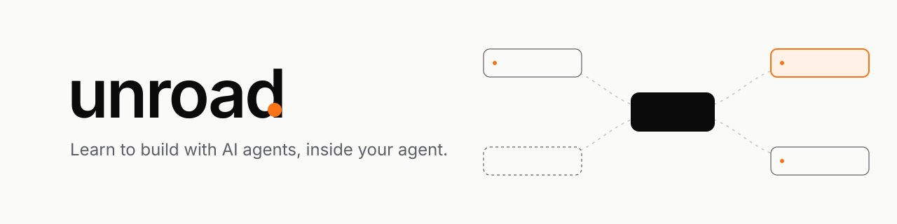
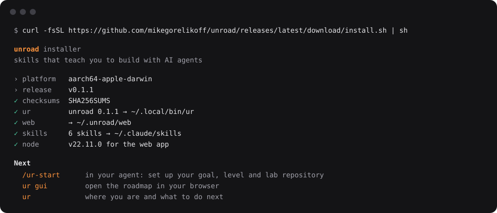
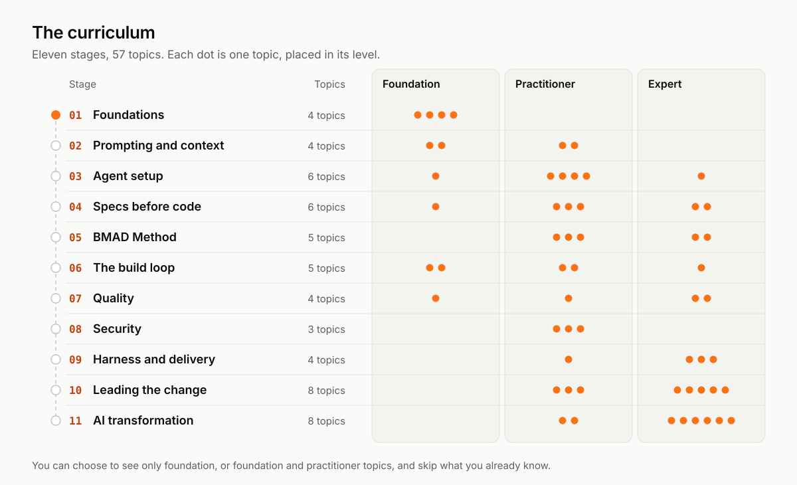
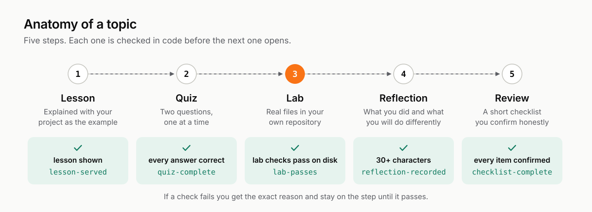
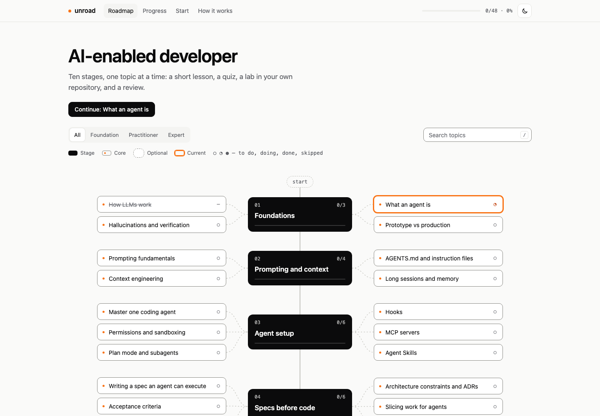
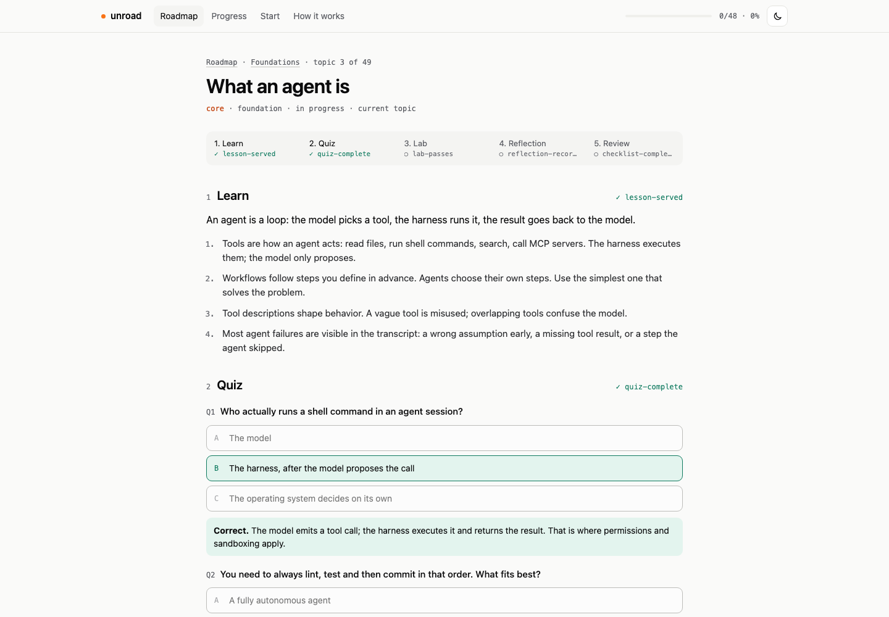
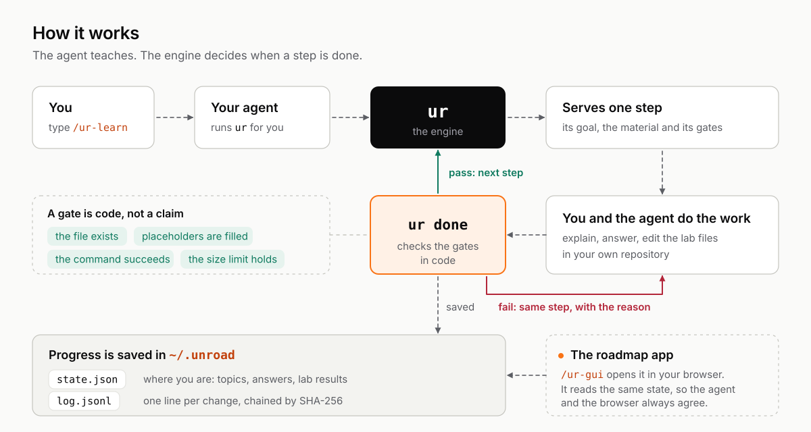

<p align="center">
  <picture>
    <source media="(prefers-color-scheme: dark)" srcset="assets/banner-dark.svg">
    
  </picture>
</p>

<p align="center">
  <a href="https://github.com/mikegorelikoff/unroad/releases/latest"></a>
  
  <a href="LICENSE"></a>
</p>

**unroad turns your coding agent into a mentor that teaches you to build software with AI agents.** Ten stages, 49 topics. Each topic is a short lesson, a quiz, a hands-on lab in your own repository, a reflection and a review. You talk to your agent; it leads you one step at a time, and a small engine it runs checks your work in code, so "done" means done.

## Install

macOS and Linux:

```bash
curl -fsSL https://github.com/mikegorelikoff/unroad/releases/latest/download/install.sh | sh
```

Windows (PowerShell):

```powershell
irm https://github.com/mikegorelikoff/unroad/releases/latest/download/install.ps1 | iex
```

<p align="center">
  
</p>

That is all. The installer:

- downloads the engine your agent uses (`ur`, one small binary) and checks it against the release's SHA-256 sums before installing anything;
- puts it in `~/.local/bin` (Windows: `%LOCALAPPDATA%\unroad\bin`, added to your PATH);
- installs the roadmap web app into `~/.unroad/web`;
- installs the six skills into every agent it finds: Claude Code (`~/.claude/skills`) and Codex (`~/.codex/skills`);
- adds a short, clearly marked unroad section to your agents' instructions so every session knows how to work with it (your own text is never touched; `--no-agents-md` skips it).

No root, no Python, no package managers. The web app needs [Node.js](https://nodejs.org) 20 or newer; everything else works without it.

## Follow the story

See the whole course through one developer's eyes: [the story of Maya](https://github.com/mikegorelikoff/unroad/wiki/00-Story-Meet-Maya), a developer on a TypeScript online store, from install to rolling the practices out to her team. Every prompt she sends, what the agent answers, the files that appear and the checks that pass.

## Your first ten minutes

1. Open your agent (Claude Code, Codex or any agent that supports Agent Skills) in a repository you work on.
2. Type **`/ur-start`**. It asks your goal, how many hours a week you have, your level, and which repository to use for labs, then lets you skip what you already know.
3. Type **`/ur-learn`**. Your first topic starts: the agent explains the lesson in terms of your project, quizzes you, coaches you through a real lab, and only moves on when the checks pass.
4. Type **`/ur-gui`** to open the whole roadmap in your browser. It updates live while you learn.

Come back any time with `/ur-learn`. Your progress is saved, so a new session picks up exactly where you stopped.

## What you will learn

<p align="center">
  <picture>
    <source media="(prefers-color-scheme: dark)" srcset="assets/wiki/curriculum-map-dark.svg">
    
  </picture>
</p>

| | Stage | Topics |
|---|---|---|
| 01 | **Foundations** | how LLMs and agents work, hallucinations and verification, prototype vs production |
| 02 | **Prompting and context** | prompting, context engineering, AGENTS.md, long sessions and memory |
| 03 | **Agent setup** | one agent in depth, permissions and sandboxing, plan mode and subagents, hooks, MCP, Agent Skills |
| 04 | **Specs before code** | executable specs, acceptance criteria, working backwards, architecture decisions, slicing, readiness |
| 05 | **BMAD Method** | phases and roles, planning, solutioning, the build cycle, quick flow and existing code |
| 06 | **The build loop** | explore, plan, implement, verify; small batches; test-first; scope; legacy code |
| 07 | **Quality** | tests as feedback, reviewing AI code, adversarial review, evals for AI features |
| 08 | **Security** | OWASP for LLMs and agents, prompt injection, secrets and supply chain |
| 09 | **Harness and delivery** | guides and sensors, agents in CI, traceable commits, parallel agents |
| 10 | **Leading the change** | a story with evidence, pilots, working agreements, coaching, AI policy, metrics, team skills |

Every topic links to the best material on the subject: official documentation, standards and practical guides. Read any lesson in full in the [wiki](https://github.com/mikegorelikoff/unroad/wiki/Curriculum).

## How a topic works

<p align="center">
  <picture>
    <source media="(prefers-color-scheme: dark)" srcset="assets/wiki/topic-anatomy-dark.svg">
    
  </picture>
</p>

```
1 lesson      the mentor explains it with your project as the example, then checks you understood
2 quiz        two questions, one at a time; explanations after you answer
3 lab         you change real files in your repository; the agent checks them on disk
4 reflection  what you did and what you will do differently, in your words
5 review      a short checklist you confirm honestly
```

Labs are real work, not exercises on the side. You will write an `AGENTS.md`, add a hook, record architecture decisions, write acceptance criteria, set up an AI reviewer in CI and more. When you say you are done, your agent checks the lab in code: the file exists, every placeholder is filled in, a command succeeds, a size limit holds. When a check fails, you get the exact reason and fix it.

## The roadmap app

Type `/ur-gui` in your agent and your browser opens the roadmap: every stage and topic, what is done, what is current, and each topic as an interactive page with the lesson, the quiz, the lab checks and the checklist.

<p align="center">
  
</p>

<p align="center">
  
</p>

You can learn entirely in the browser, entirely in your agent, or mix both: they share the same progress.

## The skills

| Skill | Use it to |
|---|---|
| `/ur-start` | set up your goal, level, lab repository and what you already know |
| `/ur-learn` | learn the next topic, or a topic you name |
| `/ur-progress` | see where you are and plan the next week |
| `/ur-gui` | open the roadmap in your browser |
| `/ur-flow` | not sure which one? describe what you want and it picks |
| `/ur-doctor` | check that everything is installed and working |

## What runs under the hood

<p align="center">
  <picture>
    <source media="(prefers-color-scheme: dark)" srcset="assets/wiki/how-it-works-dark.svg">
    
  </picture>
</p>

You never need to type anything but the skills above. Under the hood your agent drives a small engine called `ur`: it serves the mentor one step at a time, checks quiz answers and labs in code, saves your progress and runs the roadmap app. Because the checks are code, the agent cannot skip a step or mark work done that is not done, and a new session always resumes where you stopped.

## Your data stays on your machine

Progress lives in `~/.unroad/`, lab files in your repository under `.unroad/labs/`. Nothing is sent anywhere: no accounts, no telemetry, no network calls except the installer's download. The web app listens only on `127.0.0.1`.

## Update and uninstall

Update: run the install command again.

Uninstall (keeps your progress):

```bash
curl -fsSL https://github.com/mikegorelikoff/unroad/releases/latest/download/install.sh | sh -s -- --uninstall
```

Add `--purge` to delete your progress as well.

## Questions

**Which agents work?** Claude Code and Codex are installed automatically. Any agent that reads Agent Skills (`SKILL.md` folders) works: point the installer at its skills folder with `--target <dir>`.

**Do I need to finish everything?** No. `/ur-start` lets you skip what you know, and you can choose to see only foundation or practitioner topics.

**Can a team use it?** Yes. Each person installs it and learns in their own repository; the last stage, *Leading the change*, is about bringing these practices to a team.

**Something broke.** Type `/ur-doctor` in your agent. It finds what is wrong and fixes what it safely can.

More detail: [the guide](GUIDE.md) and the [wiki](https://github.com/mikegorelikoff/unroad/wiki), which has every lesson in full, a glossary and the whole curriculum.

## License

[Apache-2.0](LICENSE).
